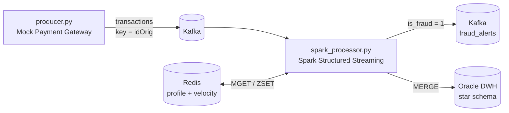

# Real-time Fraud Detection Pipeline

Pipeline phát hiện gian lận giao dịch thời gian thực sử dụng Kafka, Spark Structured Streaming, Redis và Oracle.

## Kiến Trúc



- **Data Generator** ([producer.py](data_generator/producer.py)): sinh khoảng 500 giao dịch/giây, có cố tình chèn các kịch bản gian lận. Mỗi giao dịch dùng UUID làm `transaction_id`, timestamp là thời điểm thực.
- **Redis**:
  - Lookup cache profile khách hàng (`ACC_00001 → {age, home_city, risk_segment}`), nạp bởi [init_redis.py](database/init_redis.py).
  - Trạng thái cửa sổ trượt cho luật velocity.
- **Spark Streaming**, chia thành 4 module:
  - [spark_processor.py](streaming_app/spark_processor.py): đọc Kafka, enrich, chấm điểm.
  - [fraud_rules.py](streaming_app/fraud_rules.py): các luật gian lận.
  - [redis_store.py](streaming_app/redis_store.py): truy cập Redis.
  - [oracle_sink.py](streaming_app/oracle_sink.py): ghi xuống Oracle.
- **Sinks**:
  - Giao dịch gian lận được đẩy sang topic `fraud_alerts`.
  - Mọi giao dịch được ghi vào Oracle theo star schema.

## Prerequisites

- Python **3.10+** (yêu cầu của PySpark 4.1)
- Java **17 hoặc 21** (Spark chạy trên JVM): `java -version`
- Docker & Docker Compose
- `make` (tùy chọn; có sẵn trên macOS/Linux)

## Chạy nhanh

```bash
make env          # tạo .env từ .env.example -> sửa các mật khẩu trong .env
make install      # pip install -r requirements-dev.txt
make up           # Kafka + Redis + Oracle, tự tạo topic và schema, chờ tới khi healthy
make init-redis   # nạp 10,000 profile khách hàng vào Redis

make spark        # Terminal 1: Spark Streaming
make producer     # Terminal 2: sinh giao dịch
make alerts       # Terminal 3 (tùy chọn): xem cảnh báo gian lận realtime
```

Gõ `make help` để xem toàn bộ lệnh. Bảng dưới liệt kê lệnh tương đương nếu không dùng `make`:

| Bước | Lệnh |
|---|---|
| Hạ tầng | `docker compose up -d --wait kafka redis oracle-db && docker compose up kafka-init` |
| Redis | `python database/init_redis.py` |
| Spark | `python streaming_app/spark_processor.py` |
| Producer | `python data_generator/producer.py` |

Lần đầu `make up` mất khoảng 1–3 phút để Oracle khởi tạo. Container tự tạo user ứng dụng (`DB_USER`) trong `FREEPDB1` và chạy [init_oracle.sql](database/init_oracle.sql). Script khởi tạo chỉ chạy khi volume `oracle-data` còn trống. Muốn tạo lại schema thì chạy `make reset-oracle`, lệnh này **xóa toàn bộ dữ liệu**.

Log mong đợi:

```
# spark_processor.py
INFO [Batch 42] 313 giao dịch, 12 gian lận, xử lý 0.44s
# producer.py
INFO Đã đẩy 36000 GD | kịch bản: {'normal': 34729, 'drain': 720, 'velocity': 67, 'night': 205} | lỗi gửi: 0
```

## Luật Phát Hiện Gian Lận

Định nghĩa trong [fraud_rules.py](streaming_app/fraud_rules.py). Mỗi luật có một trọng số (weight).

| ID | Luật | Điều kiện | Risk | Weight |
|---|---|---|---|---|
| 2 | Full Balance Drain | `amount ≈ oldbalanceOrg` (rút sạch) | High | 0.9 |
| 3 | High Risk Account Large Transfer | `risk_segment = High` và `amount > 10,000` | High | 0.7 |
| 4 | High Velocity Large Transactions | ≥ 3 giao dịch ≥ 10,000 của cùng tài khoản trong 30 giây | High | 0.8 |
| 5 | Large Transaction At Night | 03:00–04:59 (giờ `APP_TIMEZONE`) và `amount ≥ 10,000` | Medium | 0.6 |

Cách tính điểm:

- **`fraud_score`** = `1 − Π(1 − weight)` trên các luật bị kích hoạt, trong khoảng 0 → 1.
- **`is_fraud = 1`** khi `fraud_score ≥ 0.5`.
- **`fraud_reason_id`** là luật có weight cao nhất trong các luật bị kích hoạt. Giao dịch bình thường có `fraud_reason_id = 1` (No Fraud).

Luật velocity dùng sorted set `velocity:<account_id>` trong Redis, đếm theo event time. Member là `transaction_id` nên khi Spark xử lý lại một batch thì không bị đếm trùng.

## Data Model (Oracle)

```
dim_accounts (account_id PK, age, home_city, risk_segment)        -- SCD Type 1
dim_time     (time_id PK = YYYYMMDDHH, hour, day, month, year, day_of_week)
dim_fraud_reason (fraud_reason_id PK, reason_name, risk_level)    -- seed từ fraud_rules.py

fact_transactions (
    transaction_id PK (UUID), account_id FK, dest_account_id, time_id FK, fraud_reason_id FK,
    transaction_type, amount, fraud_score, is_fraud,
    event_ts, ingested_at, processed_at
)
```

Ý nghĩa ba cột thời gian:

| Cột | Ý nghĩa |
|---|---|
| `event_ts` | Thời điểm giao dịch |
| `ingested_at` | Thời điểm message vào Kafka |
| `processed_at` | Thời điểm ghi vào DWH |

Cả ba đều tính theo `APP_TIMEZONE`. Dùng `processed_at − ingested_at` để đo độ trễ của pipeline.

## Kiểm Tra Kết Quả

### Oracle

```bash
make sql
```

```sql
-- Số giao dịch theo lý do
SELECT r.reason_name, COUNT(*) cnt, ROUND(AVG(f.fraud_score), 3) avg_score
FROM fact_transactions f JOIN dim_fraud_reason r USING (fraud_reason_id)
GROUP BY r.reason_name ORDER BY cnt DESC;

-- Độ trễ end-to-end (Kafka -> Oracle) trong 5 phút gần nhất, đơn vị giây
WITH lat AS (
    SELECT EXTRACT(HOUR FROM d) * 3600 + EXTRACT(MINUTE FROM d) * 60 + EXTRACT(SECOND FROM d) AS s
    FROM (SELECT processed_at - ingested_at AS d FROM fact_transactions
          WHERE processed_at > (SELECT MAX(processed_at) FROM fact_transactions) - INTERVAL '5' MINUTE)
)
SELECT ROUND(AVG(s), 3) avg_s,
       ROUND(PERCENTILE_CONT(0.95) WITHIN GROUP (ORDER BY s), 3) p95_s
FROM lat;
```

### Redis

```bash
docker exec -it redis_cache redis-cli
> GET ACC_00001
> KEYS velocity:*
```

### Kafka

```bash
make alerts                          # topic fraud_alerts
docker exec -it kafka kafka-console-consumer --bootstrap-server localhost:9092 \
  --topic transactions --from-beginning --max-messages 5
```

## Cấu Hình

Toàn bộ cấu hình đọc từ `.env`; xem [.env.example](.env.example) và [config.py](config.py).

| Biến | Mặc định | Ý nghĩa |
|---|---|---|
| `DB_USER`, `DB_PASSWORD` | (bắt buộc) | User ứng dụng Oracle, container tự tạo |
| `ORACLE_ADMIN_PASSWORD` | (bắt buộc) | Mật khẩu SYS/SYSTEM, chỉ docker-compose dùng |
| `DB_HOST`, `DB_PORT`, `DB_SERVICE_NAME` | `localhost`, `1521`, `FREEPDB1` | Kết nối Oracle |
| `KAFKA_BOOTSTRAP_SERVERS` | `localhost:9092` | Kafka broker |
| `KAFKA_TOPIC_TRANSACTIONS`, `KAFKA_TOPIC_FRAUD_ALERTS` | `transactions`, `fraud_alerts` | Tên topic |
| `REDIS_HOST`, `REDIS_PORT` | `localhost`, `6379` | Redis |
| `APP_TIMEZONE` | `Asia/Ho_Chi_Minh` | Múi giờ nghiệp vụ |
| `NUM_ACCOUNTS` | `10000` | Số tài khoản (Redis và producer dùng chung) |
| `PRODUCER_RATE` | `500` | Giao dịch / giây |
| `SPARK_MASTER` | `local[*,4]` | Master Spark, mỗi task retry tối đa 4 lần |
| `CHECKPOINT_DIR` | `streaming_app/.checkpoint` | Lưu offset Kafka đã xử lý |
| `STARTING_OFFSETS` | `latest` | Chỉ áp dụng khi chưa có checkpoint |
| `MAX_OFFSETS_PER_TRIGGER` | `5000` | Giới hạn kích thước batch khi xử lý bù backlog |
| `SPARK_DRIVER_MEMORY` | `512m` | Heap của Spark driver |
| `TRIGGER_INTERVAL` | (rỗng) | Rỗng = micro-batch liên tục; `2 seconds` = ít CPU hơn, độ trễ cao hơn |

## Tài Nguyên

Số liệu đo trên MacBook 8 core / 16 GB khi chạy tải 500 GD/s:

| Thành phần | RAM | CPU |
|---|---|---|
| Oracle (SGA 1G + PGA 256M) | ~1.7 GB | 15–45% |
| Spark JVM + 3 Python worker + driver | ~1.2 GB | 40–60% |
| Kafka (heap ≤ 512M) | ~0.4 GB | 15–35% |
| Producer | ~40 MB | ~10% |
| Redis | ~20 MB | ~1% |
| **Tổng** | **~3.3 GB** | **~1–1.5 core** |

Cách giảm thêm:

- **Docker Desktop → Settings → Resources:** các container chỉ cần khoảng 2,5 GB. Docker Desktop thường được cấp 8 GB và giữ phần RAM đó, nên hạ xuống 4 GB sẽ trả lại RAM cho macOS. Lưu ý: nếu bạn còn chạy các stack Docker khác thì cần cân nhắc mức này.
- **Demo nhẹ:** đặt `PRODUCER_RATE=100` để giảm tải toàn bộ pipeline khoảng 5 lần.
- **Ít CPU hơn:** đặt `TRIGGER_INTERVAL=2 seconds`, đổi lại độ trễ tăng lên khoảng 1–2 giây.
- **Không dùng thì tắt:** chạy `make down`. Oracle và Kafka vẫn tốn tài nguyên kể cả khi không có giao dịch nào.

## Độ Tin Cậy

- **At-least-once:**
  - Lỗi ghi Oracle không bị bỏ qua. Spark retry task, và nếu vẫn lỗi thì query dừng. Batch chỉ được ghi vào checkpoint khi đã ghi xong.
  - Processor tự khởi động lại query từ checkpoint, tối đa 5 lần liên tiếp, với backoff 10 → 120 giây.
- **Idempotent sink:**
  - Fact và dim đều ghi bằng `MERGE` theo khóa, nên xử lý lại một batch không tạo dòng trùng.
  - Topic `fraud_alerts` có thể nhận trùng message khi retry, nên consumer cần khử trùng theo `transaction_id`.
- **Đã kiểm thử thực tế:** tắt Oracle giữa chừng rồi bật lại. Processor tự phục hồi và số dòng trong `fact_transactions` khớp chính xác với số giao dịch producer đã gửi.
- **Lỗi đã biết của Spark 4.1.1:** sau khi khôi phục một batch dở dang, Spark có thể ném `NullPointerException` tại `KafkaMicroBatchStream.metrics`. Vòng tự khởi động lại xử lý được trường hợp này.

## Test

```bash
make test
```

Unit test cho các luật gian lận, cách parse thời gian, và kiểm tra rằng producer sinh đúng các kịch bản mà luật phát hiện được.

## Cấu Trúc Thư Mục

```
├── config.py                    # cấu hình tập trung (.env)
├── docker-compose.yml           # Kafka (+ kafka-init), Redis, Oracle
├── Makefile
├── data_generator/producer.py
├── database/
│   ├── init_oracle.sql          # star schema
│   ├── init_redis.py            # nạp profile khách hàng
│   └── oracle-init/             # script tự chạy khi Oracle khởi tạo lần đầu
├── streaming_app/
│   ├── spark_processor.py
│   ├── fraud_rules.py
│   ├── redis_store.py
│   └── oracle_sink.py
└── tests/
```

## Dừng Pipeline

```bash
# Ctrl+C ở terminal Spark và Producer (hoặc gửi SIGTERM): cả hai đều dừng gọn
make down     # dừng container, giữ dữ liệu
make clean    # dừng container, XÓA volume và checkpoint Spark
```

## Troubleshooting

| Lỗi | Nguyên nhân | Cách sửa |
|-----|-----------|---------|
| `Thiếu cấu hình: DB_USER, DB_PASSWORD` | Chưa có `.env` | `make env` rồi điền mật khẩu |
| `NoBrokersAvailable` / `Connection refused: localhost:9092` | Kafka chưa chạy | `make up`, kiểm tra `docker compose ps` |
| `DPY-6005` / `ORA-12514` | Oracle chưa sẵn sàng | Chờ container `healthy`, xem `docker logs oracle-db` |
| `ORA-01017` (sai user/mật khẩu) | Đổi `DB_PASSWORD` sau khi volume đã khởi tạo | `make clean && make up` để khởi tạo lại |
| `ORA-00942: table or view does not exist` | Schema chưa được tạo | `make reset-oracle` |
| `Java gateway process exited` | Thiếu Java hoặc sai phiên bản | Cài JDK 17/21, kiểm tra `java -version` |
| `Unable to load native-hadoop library` | Cảnh báo bình thường khi chạy local | Bỏ qua |

## Tài Liệu Liên Quan

- Kafka: https://kafka.apache.org/quickstart
- Spark Structured Streaming: https://spark.apache.org/docs/latest/streaming/index.html
- Oracle Database Free (image gvenzl): https://github.com/gvenzl/oci-oracle-free
